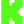

# Support ChiefGyk3D

A modern, responsive donation and support page featuring cryptocurrency tips, merch store, and various support platforms.

## 🌐 Live Site

[support.chiefgyk3d.com](https://support.chiefgyk3d.com)

## ✨ Features

- **Modern Dark Theme** - Sleek design with animated gradient backgrounds
- **Cryptocurrency Support** - Bitcoin, Monero, Ethereum, and Solana with one-click copy
- **Multiple Platforms** - Merch store, Patreon, and StreamElements integration
- **Social Links** - All major platforms (YouTube, Twitch, TikTok, Kick, Mastodon, Bluesky, GitHub, Discord, Matrix)
- **Fully Responsive** - Looks great on mobile and desktop
- **Smooth Animations** - Subtle hover effects and entrance animations

## 🛠️ Tech Stack

- HTML5 and CSS3 (custom properties, flexbox, grid), no framework, no build step
- Vanilla JavaScript in one same-origin file (`support.js`, copy buttons only)
- Brand tokens in `tokens.css`; Orbitron (headings) and Jost (body) self-hosted from `fonts/` (SIL OFL 1.1, license text beside each)
- Nothing is loaded from a third-party host. `_headers` sets a strict Content Security Policy (Cloudflare Pages)

## 📁 Project Structure

```
├── index.html          # The page (no inline script or style)
├── style.css           # Layout and components, tokens only
├── tokens.css          # Brand tokens (copied from the blog, see below)
├── support.js          # Copy-to-clipboard
├── _headers            # CSP and security headers
├── addresses.txt       # Single source of truth list for the wallet addresses
├── scripts/check.sh    # Static checks (run it before every PR)
├── fonts/              # Orbitron and Jost, with OFL license texts
├── README.md           # This file
└── media/
    ├── mascot-*.webp       # Renegade Tux derivatives (copied from the blog)
    ├── favicon-32.png      # Favicon
    ├── pixelfed.png        # Pixelfed icon (the brand kit has none)
    ├── qr-btc|xmr|eth|sol.svg  # Wallet QR codes (copied from the blog)
    ├── social/             # Social glyphs, used as CSS masks (copied from the blog)
    ├── ui/                 # Copy and QR glyphs
    ├── streamelements.png  # StreamElements logo (signature block below)
    └── icons/              # Brand-coloured SVGs used by the signature block; the page also masks the coin ones
```

## 🎨 Brand source and how to update tokens

The look follows the brand kit as implemented by the blog
([no-php-no-cry](https://github.com/ChiefGyk3D/no-php-no-cry)):

- `tokens.css` is a copy of the blog's generated `assets/css/tokens.css`, built from its `brand/tokens.json`. The commit it was copied from is named in the file header (`d2dffae`). This is the only file allowed to hard-code a color.
- To update: change `brand/tokens.json` in the blog, regenerate (`python3 -I scripts/gen-tokens.py`), copy `assets/css/tokens.css` here, change the font paths from `../fonts/` to `fonts/`, and update the commit named in the header.
- Fonts (`fonts/`), `media/social/*.svg`, `media/mascot-*.webp`, `media/favicon-32.png` and `media/qr-*.svg` are unmodified copies of the blog's `static/` files. Wallet QR codes are generated by the blog's `scripts/gen-support-qr.sh`; the blog's CI checks them against the addresses.
- Use only the official Renegade Tux artwork; never redraw it.
- The footer reads "Copyright 2026 Renegade Penguin LLC". The year is typed by hand because the page has no build step; bump it in January.
- `scripts/check.sh` fails on an external host, an inline script or style, a hard-coded color outside `tokens.css`, a missing `alt`, a loosened CSP, or an address that differs from `addresses.txt`, `SIGNATURE.md`, this README or the QR code's `<desc>`. `scripts/check.sh --self-test` proves each check fails on a bad copy.

## 🚀 Deployment

This is a static site that can be hosted on any web server or static hosting platform:

- GitHub Pages
- Cloudflare Pages
- Netlify
- Vercel
- Any web server

Simply upload the files and you're good to go!

## 📄 License

MIT License - Feel free to use this as a template for your own support page.

---

Made with ❤️ by [ChiefGyk3D](https://github.com/ChiefGyk3D)

---

## 💝 Support This Project

If you find Support ChiefGyk3D useful, consider supporting continued development.
Everything is also collected at **[support.chiefgyk3d.com](https://support.chiefgyk3d.com)**.

### Recurring Support

<div align="center">
<table>
  <tr>
    <td align="center" width="150">
      <a href="https://patreon.com/chiefgyk3d" title="Patreon">
        <br>
        <sub><b>Patreon</b></sub>
      </a>
    </td>
    <td align="center" width="150">
      <a href="https://streamelements.com/chiefgyk3d/tip" title="StreamElements">
        <br>
        <sub><b>StreamElements</b></sub>
      </a>
    </td>
    <td align="center" width="150">
      <a href="https://shop.chiefgyk3d.com/" title="Merch Store">
        <br>
        <sub><b>Merch Store</b></sub>
      </a>
    </td>
  </tr>
</table>
</div>

### Cryptocurrency Tips

<div align="center">
<table>
  <tr>
    <td align="center" width="60"></td>
    <td><b>Bitcoin</b><br><code>bc1qztdzcy2wyavj2tsuandu4p0tcklzttvdnzalla</code></td>
  </tr>
  <tr>
    <td align="center" width="60"></td>
    <td><b>Monero</b><br><code>84Y34QubRwQYK2HNviezeH9r6aRcPvgWmKtDkN3EwiuVbp6sNLhm9ffRgs6BA9X1n9jY7wEN16ZEpiEngZbecXseUrW8SeQ</code></td>
  </tr>
  <tr>
    <td align="center" width="60"></td>
    <td><b>Ethereum</b><br><code>0x554f18cfB684889c3A60219BDBE7b050C39335ED</code></td>
  </tr>
  <tr>
    <td align="center" width="60"></td>
    <td><b>Solana</b><br><code>5T8h3HbyvHgLxwXgchRYbHSqRjZyAr8J7uwjLN9Fh8Jh</code></td>
  </tr>
</table>
</div>

---

## 👤 Author & Socials

<div align="center">
<table>
  <tr>
    <td align="center" width="90"><a href="https://social.chiefgyk3d.com/@chiefgyk3d" title="Mastodon"><br><sub>Mastodon</sub></a></td>
    <td align="center" width="90"><a href="https://bsky.app/profile/chiefgyk3d.com" title="Bluesky"><br><sub>Bluesky</sub></a></td>
    <td align="center" width="90"><a href="https://twitch.tv/chiefgyk3d" title="Twitch"><br><sub>Twitch</sub></a></td>
    <td align="center" width="90"><a href="https://www.youtube.com/channel/UCvFY4KyqVBuYd7JAl3NRyiQ" title="YouTube"><br><sub>YouTube</sub></a></td>
    <td align="center" width="90"><a href="https://kick.com/chiefgyk3d" title="Kick"><br><sub>Kick</sub></a></td>
    <td align="center" width="90"><a href="https://www.tiktok.com/@chiefgyk3d" title="TikTok"><br><sub>TikTok</sub></a></td>
    <td align="center" width="90"><a href="https://discord.chiefgyk3d.com" title="Discord"><br><sub>Discord</sub></a></td>
    <td align="center" width="90"><a href="https://matrix-invite.chiefgyk3d.com" title="Matrix"><br><sub>Matrix</sub></a></td>
  </tr>
</table>
</div>

<div align="center"><sub>Made with ❤️ by <a href="https://github.com/ChiefGyk3D">ChiefGyk3D</a></sub></div>
